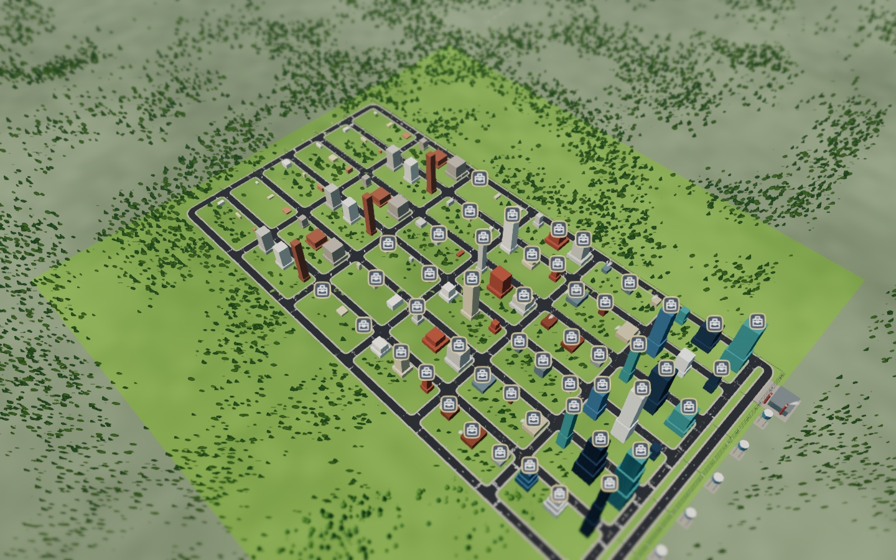
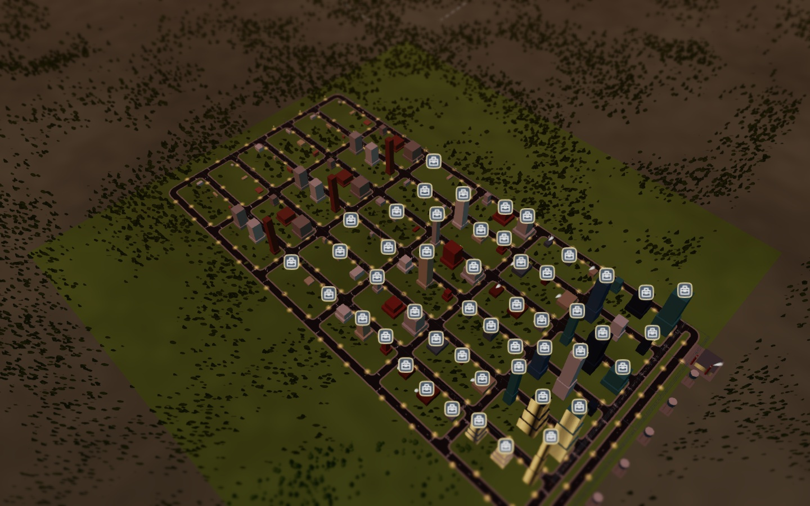
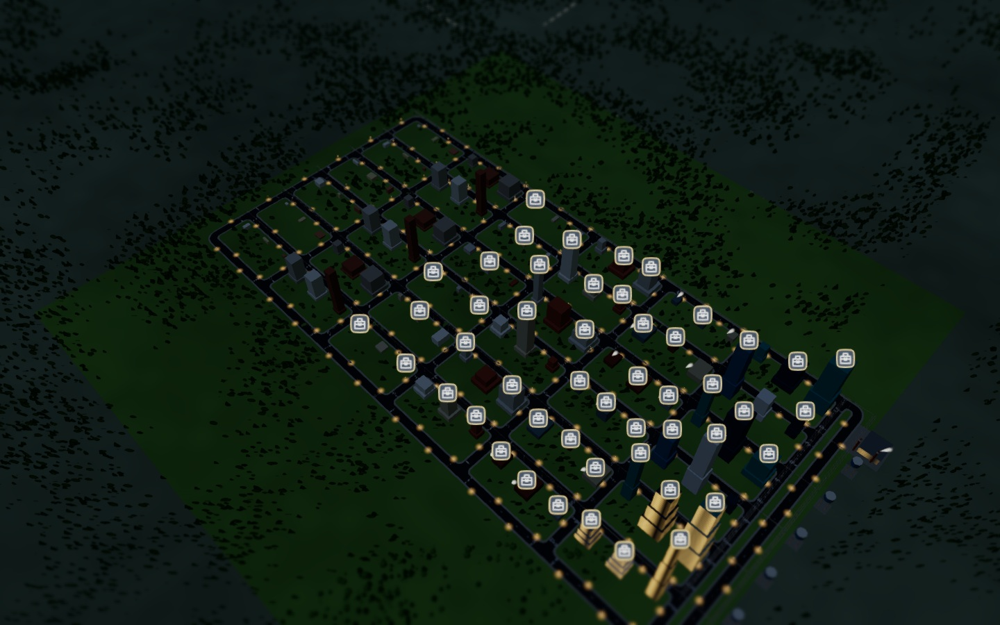
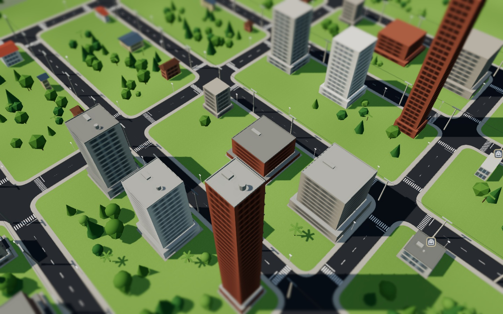
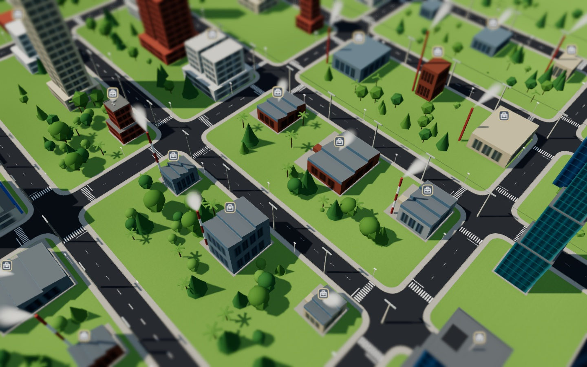
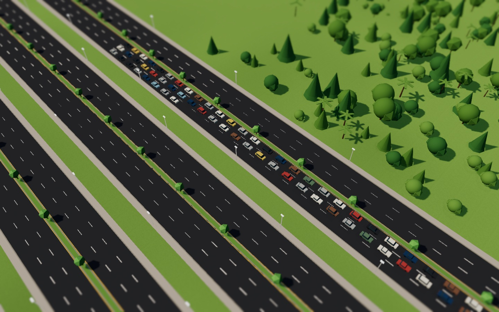

# M3 美術整體驗收

M3-01～M3-20 的地形、水面、光照、日夜、陰影後製、正式模型、LOD、車流、施工特效、UI、音效、音樂與畫質控制已整合到一般遊戲。這份紀錄對應 ART §13；測試使用實際 WebGL renderer 與正常存讀檔流程，未用圖片合成或替代渲染器。

## 本輪修正

- 暫停設定改用既有色板的不透明背景，避免底下 HUD 文字穿透。
- 探索城市時收起建造說明與重複摘要，保留工具分類；點建造工具立即恢復。手機橫式的空面板不再占用右側點選空間。
- README 更新到 M3，移除「通勤尚未實作」「音量尚未啟用」等過期說明。

## ART §13 檢查

| 項目               | 證據與範圍                                                                                                           |
| ------------------ | -------------------------------------------------------------------------------------------------------------------- |
| 400 m 高度分區辨識 | `*-400m.jpg`，程式驗證鏡頭相對地面高度 400 m；低矮住宅、塔樓、店舖、工廠與辦公量體／色板可辨。                       |
| 白天、黃昏、夜間   | 三裝置各 12:00／19:00／22:00，由存檔的通勤時鐘控制；日夜色調、窗光、路燈隨時間改變。                                 |
| 道路／地面重疊     | 選定全景、近街及工業區的不同視角檢視，未見重疊條紋；道路與地形分離、交叉口邊界清楚。不是對所有可能城市的無限量保證。 |
| 色彩來源           | 本輪只引用既有 CSS tokens；模型、窗光與地形仍取自 data/palette.ts 及既有共用 atlas，沒有新增任意 UI／建築色碼。      |
| 命名與面數         | `npm run assets:audit` 檢查全部 248 GLB 的內容雜湊、命名與 LOD 預算，零失敗；完整數值在 art-audit.json。             |
| 手機可讀／操作     | `iPhone-390x844.jpg`、`iPhone-landscape.jpg`，頁面無水平溢位；真實工具列與 HUD 保留，設定與道路操作另有回歸。        |

正式建築是離線程序建模產出的原創 GLB，沒有宣稱使用 Blender 或外部 CC0 模型。住宅 90、商工辦 99、設施／地標 42、車輛 16，加管線示範 1，共 248；不是 248 種可建造分區。12 個地標與交通模型不代表 M4 的建造／運營功能已完成。

## 六張展示圖

展示城市由 `tests/fixtures/artReviewCity.ts` 建立：108 棟分區建築與依實際負載配置的水電／污水設施。先跑人口與職缺投影，再驗證所有建築供電、所有分區供水與排污，避免靠隱藏問題圖示美化。此為作者安排的驗收存檔，不是玩家自然成長紀錄；尚未安排居民，缺工圖示仍保留。交通圖使用既有個別居民路徑存檔。宣傳圖只暫時隱藏 HUD；三裝置 UI 驗收圖保留實際介面（僅隱藏開發 debug 文字）。

| 白天全景                                          | 黃昏                                      | 夜景                                       |
| ------------------------------------------------- | ----------------------------------------- | ------------------------------------------ |
|  |  |  |

| 街道近景                                    | 工業區                                        | 個別通勤交通                                 |
| ------------------------------------------- | --------------------------------------------- | -------------------------------------------- |
|  |  |  |

## 驗證與限制

完整單元測試 930 項通過；畫質／UI 6 項、道路 9 項與美術 3 項跨裝置案例分批驗證。新展示存檔另重驗美術三裝置。lint、typecheck、build 以及全部 GLB 稽核通過。截圖與數據位於 `screenshots/m3-20/`。

模型共 5,595,600 bytes；六首音樂共 19,067,733 bytes，音樂串流按曲下載，不算入起始 JS 或 SW precache。首次主選單 JS gzip 約 32 KB（依瀏覽器實際請求檔案加總）；測試停用 SW，這不是完整 PWA 離線安裝流量，也不是首次進入城市全部下載量。

效能數值是本機 Chrome 的 viewport／觸控模擬，不能當作實際 iPhone Safari 或 4G 效能。一般城市 draw call 目標、10 萬人口 tick、真機記憶體與 4G 首屏時間不由這組美術截圖測試證明。各場景的實測 FPS、繪製數據及模型／植被批次狀態以 JSON 保留；本展示刻意包含大量不同模型並強制高畫質／三層陰影，繪製呼叫超過 TECH 一般城市目標，不能宣稱所有效能預算已達標。瀏覽器對 AAC／Web Audio 解鎖與原生背景暫停仍需 Safari 實機驗證。
